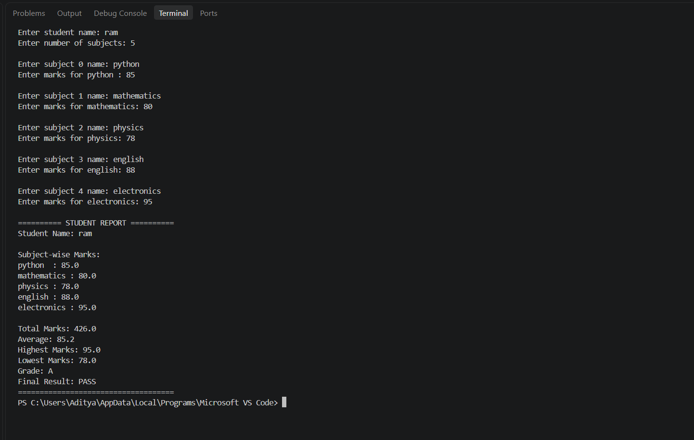

# Student Marks Management System

A beginner-friendly Python application that accepts student details, calculates marks and generates an academic performance report.

## Features

* Enter student name.
* Enter any positive number of subjects.
* Store subject names and marks.
* Validate marks between 0 and 100.
* Calculate total and average marks.
* Find the highest and lowest marks.
* Assign a grade based on the average.
* Display the final PASS or FAIL result.

## Technologies Used

* Python 3
* Lists
* Loops
* Conditional statements
* Exception handling
* Built-in functions

## How to Run

1. Install Python 3.
2. Download or clone this repository.
3. Open the project folder in VS Code.
4. Open the terminal.
5. Run:

```bash
python "students marks management system.py"
```

## Example Input

| Subject     | Marks |
| ----------- | ----: |
| Python      |    85 |
| Mathematics |    90 |
| Physics     |    78 |
| English     |    88 |
| Electronics |    95 |

## Example Results

* Total Marks: 436
* Average: 87.2
* Highest Marks: 95
* Lowest Marks: 78
* Grade: A
* Final Result: PASS

## Learning Outcomes

Through this project, I practised:

* Python programming fundamentals.
* Lists and loops.
* Conditional logic.
* Input validation.
* Exception handling.
* Calculations using built-in functions.

## Author

**Krishnam Parihar**

GitHub: https://github.com/pariharkrishnam6-ops

## 📸 Project Output

Here is a sample execution of the Student Marks Management System:



